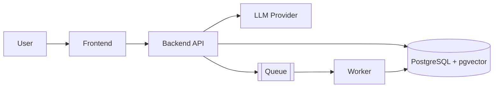

# Architecture and System Design

Choose architecture from complexity, team size, deployment needs, and operational burden.

## Principles
- Separation of concerns, clear module boundaries, composition over inheritance.
- Keep business logic independent of infrastructure where practical.
- Define explicit contracts between frontend, backend, services, and model/tool layers.
- Use dependency injection where it improves testability.
- Avoid circular dependencies, hidden global state, and oversized modules.
- Use domain-driven design only when domain complexity justifies it.

## Choices
- **Default: modular monolith.** Split into services only for a concrete benefit: independent scaling, ownership, deployment, or fault isolation.
- **Event-driven** for async workflows and decoupled integrations, when justified.
- **Queues and workers** for long-running, retryable, or scheduled work.
- Record significant decisions as ADRs (see `templates/adr.md`).

## Design deliverables (substantial projects)
- Component and data-flow overview, with a Mermaid diagram when it clarifies.
- API and event contracts.
- Data model and trust boundaries.
- Failure modes and recovery behavior.
- Deployment topology and scaling notes.

## Mermaid starter

## Scaling decisions
Do not pick architecture from a guessed traffic number. Start simple (modular monolith, one database, one cache, managed hosting), then:
1. Define the target (for example p95 latency, throughput, availability).
2. Measure under realistic load (load test plus production metrics).
3. Find the actual bottleneck (database, model latency, CPU, network, a single hot endpoint).
4. Fix that bottleneck with the smallest change (index, cache, queue, read replica, vertical scale, then horizontal scale or service extraction).
5. Re-measure and record the decision in an ADR with the trigger that would reopen it.
